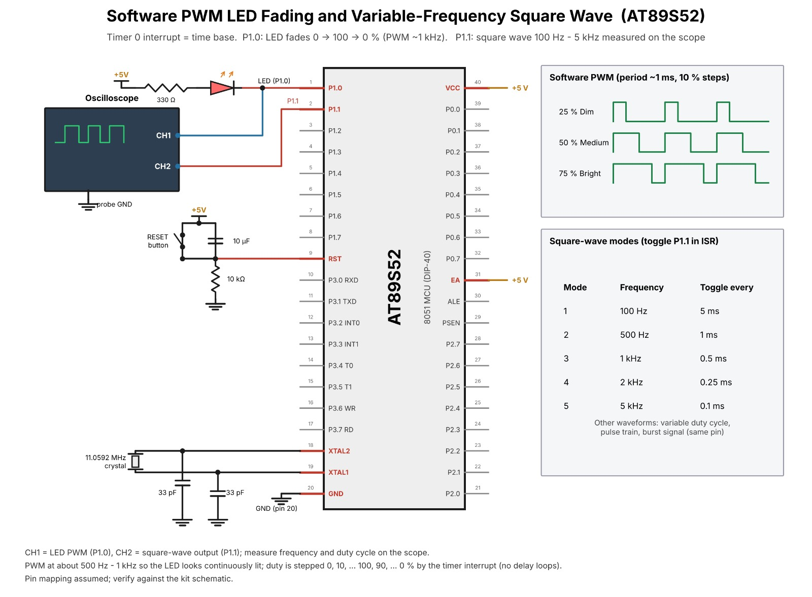

# TASK5B.1 — Software PWM LED Fading

**Registration number:** 25011102079  
**Platform:** AT89S52 / 8051, Keil µVision C51  
**Faculty assessment:** CAT5

## Objective
Software PWM LED Fading. Follow the corresponding faculty CAT task sheet for detailed behavior and acceptance criteria.

## Supplied files
- C source: `main.c`
- Keil project: `TASK2_PWM_LED_Fading_and_Square_Wave.uvproj`
- Keil startup: `STARTUP.A51`
- Compiled HEX: `Objects/8051.hex`

## Existing circuit / evidence images

## Build and verification
1. Open the supplied `.uvproj` / `.uvprojx` in Keil µVision.
2. Verify project source paths, target device, clock and pins.
3. Rebuild; enable HEX output and confirm **0 errors**.
4. Compare the behavior against the official CAT task sheet and test on the actual board.
