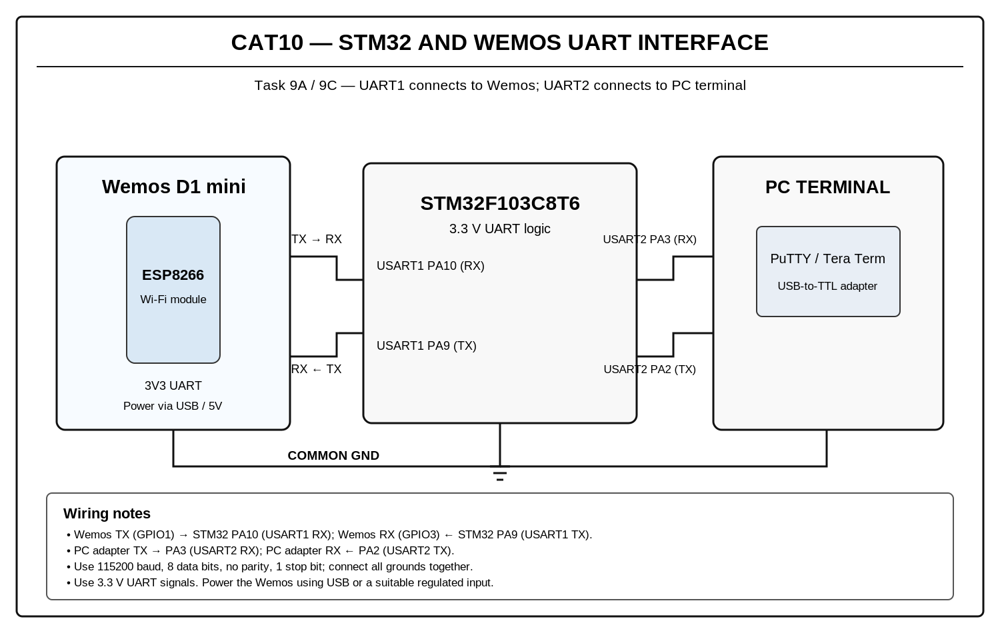

# CAT10 – Wemos ESP8266 Wi-Fi Modem Interface

## 1. Platform and Development Tools

- **Platform:** STM32 and Wemos D1 Mini (ESP8266)
- **Development Tools:** STM32CubeMX, Keil MDK-ARM
- **Programming Framework:** STM32 HAL

## 2. Objective

Establish communication between the STM32 microcontroller and Wemos ESP8266 using UART. Explore ESP8266 AT commands to configure and connect the Wi-Fi module to a wireless network.

## 3. Hardware and Components

- STM32 development board
- Wemos D1 Mini (ESP8266)
- UART connection wires
- Common ground
- USB cables
- Wi-Fi access point

## 4. Experiment Description

This experiment consists of three tasks involving UART communication and Wi-Fi modem configuration.

### TASK10A – STM32 and Wemos UART Communication

- Establish UART communication between the STM32 and Wemos ESP8266.
- Transmit data from the STM32 to the Wemos.
- Receive data through the UART interface.
- Verify successful serial communication between the two boards.

**Expected Result:** Successful UART data transmission and reception between the STM32 and Wemos.

### TASK10B – ESP8266 AT Command Interface

- Explore ESP8266 AT commands.
- Understand the commands used to configure and control the Wi-Fi module.
- Send AT commands from the STM32 through UART.
- Observe and verify the responses returned by the ESP8266.

**Expected Result:** The ESP8266 responds to valid AT commands sent by the STM32.

### TASK10C – Connect Wemos to Wi-Fi

- Configure the ESP8266 Wi-Fi connection using AT commands.
- Provide the required wireless network credentials.
- Connect the module to the available Wi-Fi network.
- Verify the connection status through the module response.

**Expected Result:** The Wemos ESP8266 successfully connects to the configured wireless network.

## 5. Project Contents

The project contains the following files and folders:

- STM32 source code
- STM32CubeMX configuration file (`.ioc`)
- Keil MDK project files
- `Core/` folder
- `Drivers/` folder
- Circuit diagram (`circuit.png`)

## 6. UART Communication and Hardware Connections

Connect the STM32 and Wemos using UART.

| STM32 | Wemos D1 Mini |
|---|---|
| UART TX | UART RX |
| UART RX | UART TX |
| GND | GND |

- Connect TX of one board to RX of the other.
- Ensure that both boards share a common ground.
- Verify the UART pin assignments and communication settings from the project configuration.
- Ensure compatible logic levels before connecting the boards.

## 7. Circuit Diagram and Pin Connections

## 8. Software and Configuration

- STM32CubeMX is used for peripheral configuration.
- Keil MDK-ARM is used to build and program the STM32 application.
- STM32 HAL libraries are used for UART communication.
- ESP8266 AT commands are used to configure and control the Wi-Fi module.

## 9. Testing and Verification

1. Open the STM32 project in Keil MDK-ARM.
2. Verify the UART configuration and pin assignments.
3. Build and program the STM32.
4. Test UART communication between the STM32 and Wemos.
5. Send ESP8266 AT commands and observe the responses.
6. Configure the Wi-Fi connection and verify the connection status.

**Security Note:** Do not include actual Wi-Fi passwords or private credentials in the public repository.