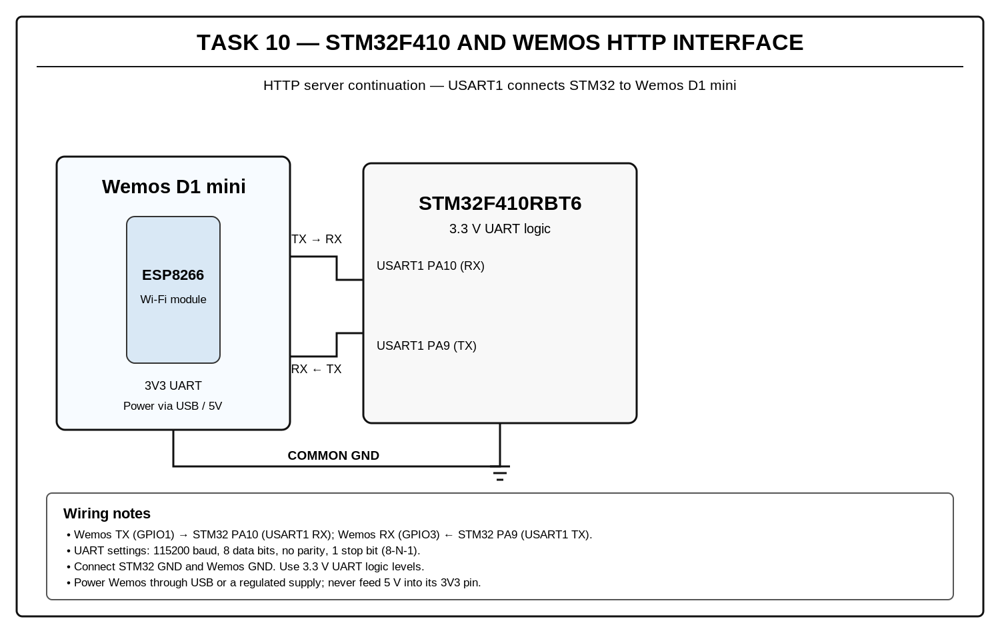

# CAT11 – HTTP Server Using STM32 and Wemos ESP8266

## 1. Platform and Development Tools

- **Platform:** STM32F410RB and Wemos ESP8266
- **Development Tools:** STM32CubeMX, Keil MDK
- **Programming Framework:** STM32 HAL

## 2. Objective

Develop an STM32-based HTTP server using the Wemos ESP8266 Wi-Fi module. Establish communication through UART AT commands, configure the ESP8266 as a TCP server, receive HTTP requests, and transmit HTTP responses that can be accessed through a web browser and Node-RED.

## 3. Hardware and Components

- STM32F410RB development board
- Wemos ESP8266 Wi-Fi module
- UART connections between STM32 and ESP8266
- Common ground connection
- USB cables and power supply
- Wi-Fi network

## 4. Experiment Description

### TASK11A – Configure ESP8266 as TCP Server

- Test AT command communication between STM32 and ESP8266.
- Enable multiple connections using `AT+CIPMUX=1`.
- Start the TCP server on port 80 using `AT+CIPSERVER=1,80`.
- Receive incoming HTTP requests through ESP8266 `+IPD` notifications.
- Observe and process the received request data.

### TASK11B – HTTP Response and Node-RED Integration

- Parse the HTTP request received from the ESP8266.
- Construct an HTTP response containing a status line, headers, and an HTML body.
- Use the two-step `AT+CIPSEND` procedure to transmit the response:
  1. Send `AT+CIPSEND=<link_id>,<data_length>`.
  2. Wait for the `>` prompt and transmit the HTTP response.
- Access the HTTP server through a web browser.
- Configure Node-RED as another HTTP client to send requests to the server.
- Display the received HTTP response using a Debug node in Node-RED.

## 5. Expected Output

The STM32 processes HTTP requests received through the Wemos ESP8266 and sends an HTTP response. The response can be accessed through a web browser and Node-RED.

## 6. Project Contents

- STM32 source code
- STM32CubeMX configuration file (`.ioc`)
- Keil MDK project files
- `Core` and `Drivers` folders
- Circuit diagram (`circuit.png`)

## 7. UART Communication and Hardware Connections

UART is used for communication between the STM32F410RB and Wemos ESP8266.

| STM32F410RB | Wemos ESP8266 |
|---|---|
| UART TX | UART RX |
| UART RX | UART TX |
| GND | GND |

**Note:** Refer to the STM32CubeMX configuration and source code for the exact UART pin assignments and communication settings. Ensure compatible logic levels and a common ground.

## 8. Circuit Diagram

## 9. Software and Configuration

1. Configure the required UART peripheral in STM32CubeMX.
2. Generate the project and open it in Keil MDK.
3. Establish UART communication with the ESP8266.
4. Send AT commands to configure the ESP8266 as a TCP server.
5. Receive HTTP requests and transmit the corresponding HTTP responses.
6. Test the server using a web browser and Node-RED.

## 10. Testing and Verification

- Verify AT command communication between STM32 and ESP8266.
- Confirm that the ESP8266 TCP server starts successfully on port 80.
- Verify that incoming HTTP requests are received through `+IPD` notifications.
- Check that the STM32 sends the constructed HTTP response.
- Access the server through a web browser.
- Verify the HTTP response in the Node-RED Debug node.