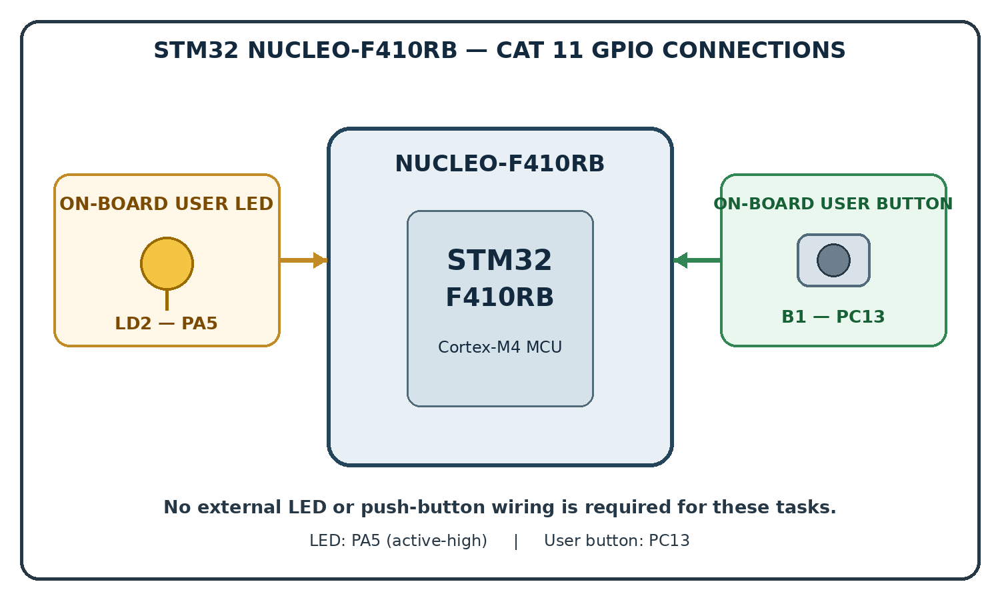

# CAT12 – GPIO LED and Button Interfacing Using STM32F410RB

## 1. Platform and Development Tools

- **Platform:** STM32F410RB NUCLEO Development Board
- **Development Tools:** STM32CubeMX, Keil MDK
- **Programming Framework:** STM32 HAL

## 2. Objective

To interface the onboard LED and user button of the STM32F410RB development board using GPIO. Implement LED blinking, button-controlled LED toggling, and short-press and long-press detection.

## 3. Hardware and Components

- STM32F410RB NUCLEO development board
- Onboard LED (LD2)
- Onboard User Button (B1)
- USB cable for programming and power supply

## 4. Pin Configuration

| Component | STM32 Pin | Configuration |
|---|---|---|
| Onboard LED (LD2) | PA5 | GPIO Output |
| User Button (B1) | PC13 | GPIO Input |

## 5. Experiment Description

### TASK12A – LED Blinking

- Configure PA5 as a GPIO output.
- Toggle the onboard LED periodically.
- Use a 500 ms delay between LED state changes.
- Observe continuous blinking of the onboard LED.

### TASK12B – Button-Controlled LED

- Configure PA5 as a GPIO output and PC13 as a GPIO input.
- Detect a button press using a LOW-to-HIGH transition.
- Implement a 30 ms debounce delay to avoid false triggering.
- Toggle the LED once for each valid button press.
- Wait for button release and debounce the release before detecting another press.

### TASK12C – Short and Long Button Press

- Implement button press detection with a 30 ms debounce delay.
- Use a 1000 ms threshold to distinguish short and long presses.

**Short Press:**
- A button press shorter than 1000 ms is treated as a short press.
- Toggle the LED state once.

**Long Press:**
- A button press lasting at least 1000 ms is treated as a long press.
- Blink the LED at 250 ms intervals while the button remains pressed.
- Restore the LED to its previous state after the long press ends.

## 6. Expected Output

| Task | Expected Behaviour |
|---|---|
| TASK12A | Onboard LED continuously blinks at 500 ms intervals. |
| TASK12B | Each valid button press toggles the LED once. |
| TASK12C – Short Press | LED toggles once when the button is pressed briefly. |
| TASK12C – Long Press | LED blinks at 250 ms intervals while the button is held and restores its previous state after release. |

## 7. Project Contents

- TASK12A, TASK12B and TASK12C source code
- STM32CubeMX configuration file (`.ioc`)
- Keil MDK project files
- `Core` and `Drivers` folders
- Circuit diagram (`circuit_diagram.png`)

## 8. Circuit Diagram

## 9. Software and Configuration

1. Configure the required GPIO pins using STM32CubeMX.
2. Generate the project and open it in Keil MDK.
3. Configure PA5 as GPIO output for LED control.
4. Configure PC13 as GPIO input for button detection.
5. Implement the respective task logic in the source code.
6. Build and program the STM32F410RB development board.

## 10. Testing and Verification

- **TASK12A:** Verify that the onboard LED blinks continuously at 500 ms intervals.
- **TASK12B:** Press the onboard button and verify that the LED toggles once per valid press.
- **TASK12C:** Test both short and long button presses and verify the corresponding LED behaviour.

## 11. Conclusion

The experiment demonstrates GPIO interfacing using the STM32F410RB development board. LED control, button input detection, debounce handling, and short-press and long-press operations are implemented across the three tasks.