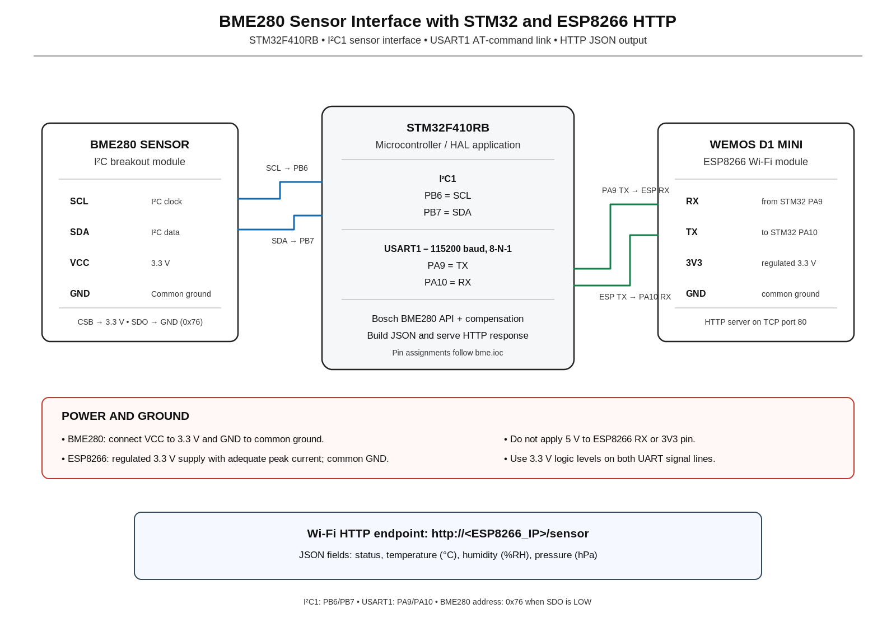
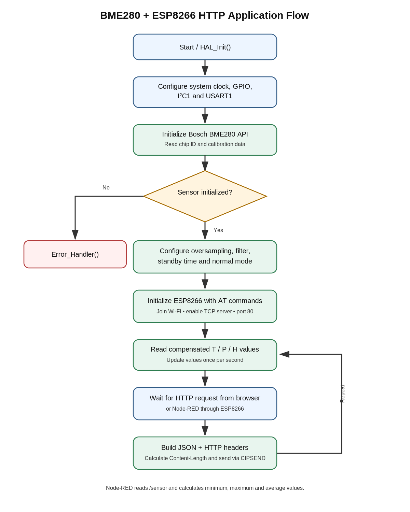

# CAT13 – BME280 Sensor Interfacing Using I2C Protocol

## 1. Platform and Development Tools

- **Platform:** STM32F410RB NUCLEO Development Board
- **Sensor:** BME280
- **Communication Protocol:** I2C
- **Development Tools:** STM32CubeMX, Keil MDK
- **Programming Framework:** STM32 HAL

## 2. Objective

To interface the BME280 environmental sensor with the STM32F410RB development board using the I2C communication protocol and read environmental measurements from the sensor.

## 3. Hardware and Components

- STM32F410RB NUCLEO development board
- BME280 sensor module
- I2C connections (SDA and SCL)
- USB cable for programming and power supply

## 4. Experiment Description – TASK13

- Configure the I2C peripheral in STM32CubeMX.
- Establish I2C communication between the STM32F410RB and BME280 sensor.
- Initialize the BME280 sensor.
- Read sensor measurements through the I2C interface.
- Process the sensor data in the STM32 application.

## 5. Sensor Measurements

The BME280 sensor supports measurement of:

- Temperature
- Relative humidity
- Atmospheric pressure

## 6. Project Contents

- STM32 source code
- BME280 sensor driver files
- STM32CubeMX configuration file (`.ioc`)
- Keil MDK project files
- `Core` and `Drivers` folders
- Circuit diagram (`circuit.png`)
- Workflow diagram (`workflow.png`)

## 7. Circuit Diagram

## 8. Program Workflow

## 9. Software and Configuration

1. Configure the required I2C peripheral using STM32CubeMX.
2. Generate the project and open it in Keil MDK.
3. Integrate the BME280 sensor driver.
4. Initialize the sensor and establish I2C communication.
5. Read the environmental measurements from the sensor.
6. Process the readings in the STM32 application.

## 10. Testing and Verification

- Build the project in Keil MDK.
- Program the STM32F410RB development board.
- Verify successful I2C communication with the BME280 sensor.
- Check the temperature, humidity and pressure readings.
- Confirm that the sensor data is received and processed correctly.

## 11. Conclusion

The experiment demonstrates interfacing the BME280 environmental sensor with the STM32F410RB development board using the I2C protocol and obtaining temperature, humidity and atmospheric pressure measurements.