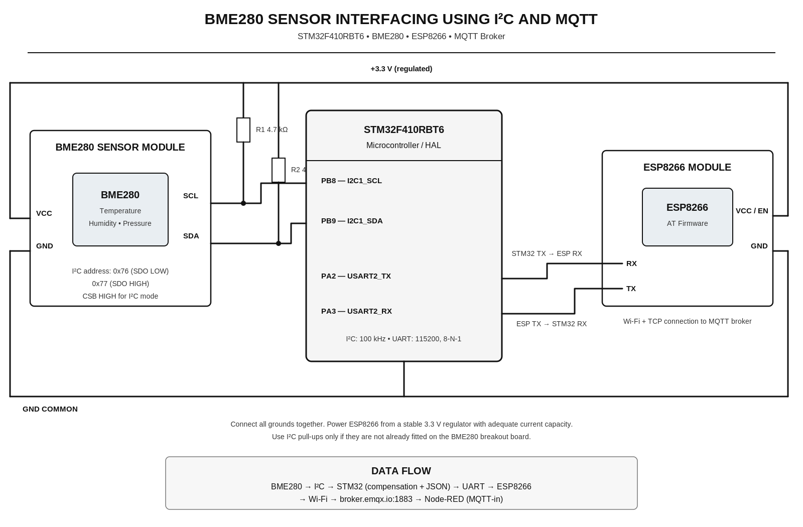
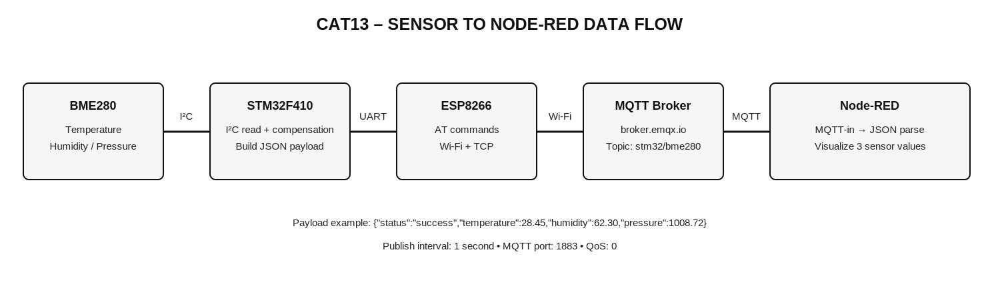

# CAT14 – BME280 Sensor Interfacing Using MQTT

## 1. Platform and Development Tools

- **Development Board:** STM32 NUCLEO-F410RB
- **Microcontroller:** STM32F410RB
- **Sensor:** BME280
- **Communication Protocol:** I2C
- **Wireless Communication:** ESP8266
- **Messaging Protocol:** MQTT
- **Development Tools:** STM32CubeMX, Keil MDK, Node-RED
- **Programming Framework:** STM32 HAL

## 2. Objective

To interface the BME280 environmental sensor with the STM32F410RB development board, acquire temperature, humidity and pressure measurements, and transmit the sensor data using MQTT through the ESP8266 Wi-Fi module. Use Node-RED to receive and visualize the published sensor data.

## 3. Hardware and Components

- STM32 NUCLEO-F410RB development board
- BME280 environmental sensor
- Wemos ESP8266 Wi-Fi module
- UART connections between STM32 and ESP8266
- I2C connections between STM32 and BME280
- USB cables and power supply
- Wi-Fi network

## 4. Experiment Description – TASK14

The experiment demonstrates sensor data acquisition and MQTT-based communication.

1. Configure I2C communication between STM32F410RB and BME280.
2. Initialize the BME280 sensor and load its calibration data.
3. Acquire temperature, humidity and atmospheric pressure measurements.
4. Process the sensor readings and prepare the data for transmission.
5. Establish UART communication between STM32 and ESP8266.
6. Configure the ESP8266 for Wi-Fi connectivity.
7. Establish MQTT communication with the configured broker.
8. Publish sensor data to the configured MQTT topic.
9. Configure Node-RED to subscribe to the MQTT topic and receive the sensor readings.
10. Display the received measurements using the Node-RED dashboard.

## 5. Sensor Measurements

The BME280 sensor provides the following environmental measurements:

| Parameter | Description |
|---|---|
| Temperature | Measures surrounding air temperature |
| Humidity | Measures relative humidity |
| Pressure | Measures atmospheric pressure |

## 6. Communication Architecture

The overall communication flow is:

```text
BME280 Sensor
      |
      | I2C
      v
STM32F410RB
      |
      | UART
      v
ESP8266 Wi-Fi Module
      |
      | Wi-Fi / MQTT
      v
MQTT Broker
      |
      | MQTT Subscription
      v
Node-RED
      |
      v
Dashboard Visualization
```

## 7. Project Contents

- STM32 source code (`TASK14.c`)
- STM32CubeMX configuration (`CAT13_BME280_MQTT.ioc`)
- Keil MDK project files
- `Core` and `Drivers` folders
- `NodeRED` folder containing Node-RED flow files
- Circuit diagram (`circuit.png`)
- Workflow diagram (`workflow.png`)

## 8. Circuit Diagram



## 9. Program Workflow



## 10. Node-RED Integration

Node-RED is used to receive and visualize sensor data published through MQTT.

- Configure an MQTT broker connection in Node-RED.
- Subscribe to the topic used by the STM32/ESP8266 application.
- Receive the published BME280 sensor readings.
- Process the incoming data using Node-RED nodes.
- Display temperature, humidity and pressure on the dashboard.

The broker address, MQTT topic and payload format should match the actual project configuration.

## 11. Testing and Verification

1. Open the STM32 project in Keil MDK.
2. Verify the I2C connection between STM32 and BME280.
3. Build and program the STM32F410RB board.
4. Check whether sensor measurements are acquired correctly.
5. Verify UART communication between STM32 and ESP8266.
6. Confirm ESP8266 Wi-Fi connectivity.
7. Verify MQTT broker connection and message publishing.
8. Check whether Node-RED receives the MQTT messages.
9. Confirm that the sensor readings are displayed correctly on the dashboard.

## 12. Conclusion

This experiment demonstrates BME280 sensor interfacing with STM32F410RB and MQTT-based wireless communication using the ESP8266 Wi-Fi module. Sensor measurements are published through an MQTT broker and received by Node-RED for monitoring and visualization.