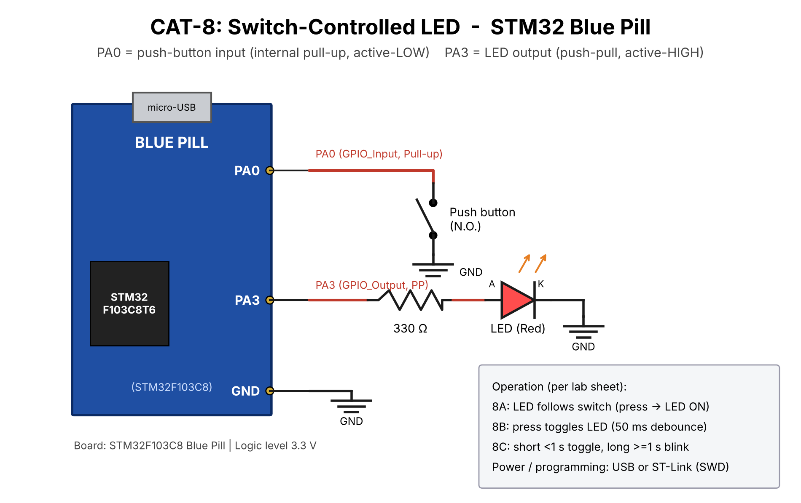

# STM32 GPIO Bring-Up and Switch-Controlled LED (Tasks 8A–8C)

## 1. Board and Microcontroller

- **Board:** Blue Pill
- **Microcontroller:** STM32F103C8T6
- **Development Environment:** STM32CubeMX, STM32CubeIDE / Keil MDK-ARM

## 2. Pin Connections

| Pin | Configuration | Description |
|---|---|---|
| PA0 | GPIO Input with Internal Pull-Up | Push-button input |
| PA3 | GPIO Output | External LED output |

### Push Button
- Connect the push button between **PA0 and GND**.
- The input is active-low because the internal pull-up is enabled.
- Pressed = LOW.
- Released = HIGH.

### LED
- Connect the external LED to PA3 through a suitable series resistor.
- Confirm the LED polarity before powering the circuit.
- The source code assumes active-high LED operation:
  - SET = LED ON
  - RESET = LED OFF

### Power Supply
Use the board's regulated 3.3 V supply arrangement. Do not apply 5 V directly to STM32 GPIO pins.

## 3. Experiment Description

This project demonstrates three STM32 GPIO-based switch and LED control operations.

| Task | Description |
|---|---|
| TASK8A | LED follows the current switch input level. |
| TASK8B | A debounced button-press event toggles the LED once. |
| TASK8C | Short/long press behaviour with non-blocking LED blinking. |

### TASK8A – Switch-Controlled LED
The LED output follows the current state of the push-button input.

### TASK8B – Debounced LED Toggle
A valid button press toggles the LED once. A 30 ms software debounce interval is used to avoid repeated triggering due to switch bounce.

### TASK8C – Short-Press and Long-Press Detection
The program distinguishes between short and long button presses.

- Debounce interval: 30 ms
- Long-press threshold: 1000 ms
- LED toggle interval: 500 ms
- Non-blocking logic is used for LED blinking.

## 4. Source Files

| File | Description |
|---|---|
| `Task_Source_Codes/TASK8A/main.c` | TASK8A – LED follows the current switch level. |
| `Task_Source_Codes/TASK8B/main.c` | TASK8B – Debounced press event toggles the LED once. |
| `Task_Source_Codes/TASK8C/main.c` | TASK8C – Short/long press behaviour with non-blocking blinking. |
| `Core/Src/main.c` | Active project source, currently configured for TASK8C. |

## 5. How to Run a Different Task

The CubeMX project compiles `Core/Src/main.c`.

To test TASK8A or TASK8B:

1. Back up the existing `Core/Src/main.c`.
2. Copy the required task's `main.c` from the corresponding `Task_Source_Codes` folder.
3. Replace the existing `Core/Src/main.c` with the selected source file.
4. Build and run the project.

**Important:** Build and test one task at a time. Do not add all three `main.c` files to the same build because each file defines its own `main()` function.

## 6. Clock Configuration

The existing CubeMX clock configuration and generated GPIO initialization are retained.

- The `.ioc` file identifies the MCU as STM32F103C8T6.
- HSE is configured with PLL ×9.
- This is the usual 8 MHz HSE to 72 MHz system-clock configuration.

Verify that the physical board has the configured 8 MHz HSE source.

## 7. Circuit Diagram and Pin Connections

## 8. Expected Outcome

- **TASK8A:** LED follows the push-button input state.
- **TASK8B:** Each valid debounced button press toggles the LED once.
- **TASK8C:** Short and long button presses produce their programmed LED behaviour.

## 9. Testing and Verification

Compile and test the selected task using STM32CubeIDE or Keil MDK-ARM with the exact STM32F103C8T6 board before hardware submission.