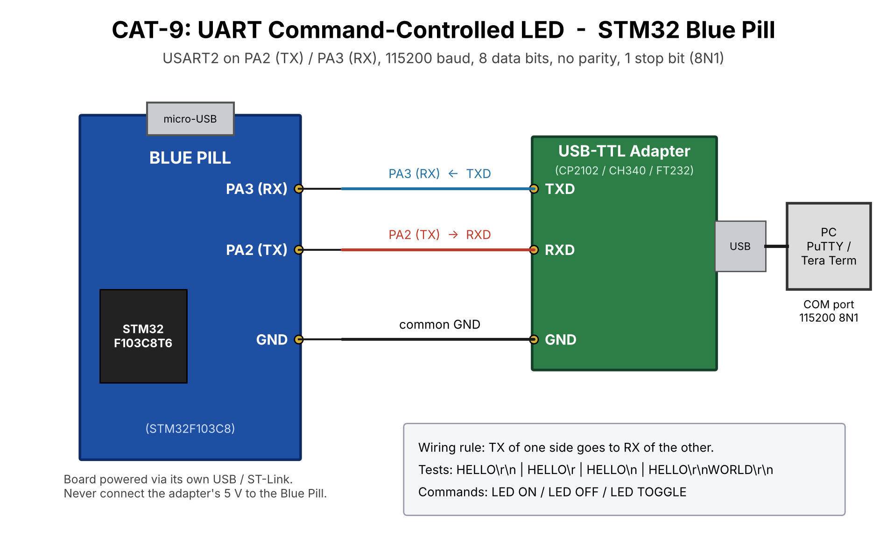

# STM32 UART Communication and Command-Controlled LED (Tasks 9A–9B)

## 1. Board and Microcontroller

- **Board:** Blue Pill
- **Microcontroller:** STM32F103C8T6
- **UART Peripheral:** USART2
- **Development Environment:** STM32CubeMX, Keil MDK-ARM

## 2. Hardware and Serial Configuration

| Parameter | Configuration |
|---|---|
| MCU | STM32F103C8T6 |
| UART Peripheral | USART2 |
| USART2_TX | PA2 |
| USART2_RX | PA3 |
| Baud Rate | 115200 |
| Data Bits | 8 |
| Parity | None |
| Stop Bits | 1 |
| Communication Format | 8N1 |
| LED | Onboard LED (PC13) |
| LED Polarity | Active-Low |

### UART Connections

Connect the USB-to-TTL adapter to the STM32 board as follows:

| USB-to-TTL Adapter | STM32 Blue Pill |
|---|---|
| TX | PA3 (USART2_RX) |
| RX | PA2 (USART2_TX) |
| GND | GND |

- Select the COM port assigned to the USB-to-TTL adapter.
- Use 3.3 V UART logic levels.
- Do not connect 5 V TTL signals directly to STM32 GPIO pins.

## 3. Experiment Description

This project demonstrates UART serial communication and command-based LED control using the STM32F103C8T6.

| Task | Description |
|---|---|
| TASK9A | Basic UART character transmission, reception, and echo. |
| TASK9B | String-based UART commands for LED control. |

### TASK9A – Basic UART Communication

**Source File:** `Task_Source_Codes/TASK9A/main.c`

The program performs the following operations:

- Transmits the character `A` to the PC serial terminal once every second.
- Receives one character from the PC.
- Transmits the received character back to the PC (echo).
- Uses polling-based HAL UART APIs.

**Expected Result:** The terminal displays the periodically transmitted character `A` and echoes characters entered by the user.

### TASK9B – String-Based Application Logic

**Source File:** `Task_Source_Codes/TASK9B/main.c`

The STM32 receives text commands through USART2 and controls the onboard LED on PC13.

The supported commands are:

| Command | Operation |
|---|---|
| `LED ON` | Turns the onboard LED ON. |
| `LED OFF` | Turns the onboard LED OFF. |
| `LED TOGGLE` | Changes the current LED state. |
| `HELP` | Displays the available command list. |

- Commands are case-insensitive.
- Enter one command per line.
- Press **Enter** to submit a command.

**Expected Result:** The STM32 recognises the entered commands and performs the corresponding LED operation.

## 4. Project Organization

| File / Folder | Description |
|---|---|
| `Core/Src/main.c` | Active project source, currently configured for TASK9B. |
| `Task_Source_Codes/TASK9A/main.c` | Standalone source code for basic UART communication. |
| `Task_Source_Codes/TASK9B/main.c` | Standalone source code for UART command-based LED control. |
| `MDK-ARM/` | Keil project files. |
| `Core/` | Application source and header files. |
| `Drivers/` | STM32 HAL and CMSIS drivers. |

## 5. How to Run a Different Task

The Keil project compiles the active source file at `Core/Src/main.c`.

To test TASK9A instead of TASK9B:

1. Back up the existing `Core/Src/main.c`.
2. Copy the source code from `Task_Source_Codes/TASK9A/main.c`.
3. Replace the contents of `Core/Src/main.c` with the TASK9A implementation.
4. Open the Keil project and build the application.

**Important:** Only one `main()` implementation should be included in a build at a time. Do not compile both task source files together.

## 6. PC Serial Terminal Configuration

Use PuTTY or another serial terminal application.

| Setting | Value |
|---|---|
| Serial Port | COM port assigned to the USB-to-TTL adapter |
| Baud Rate | 115200 |
| Data Bits | 8 |
| Parity | None |
| Stop Bits | 1 |
| Flow Control | None |

## 7. Circuit Diagram and Pin Connections

## 8. Important Board Note

This project targets the STM32F103C8T6 Blue Pill board and assumes that its onboard LED is connected to PC13 and is active-low.

If a different STM32 development board is used, verify its onboard LED pin and polarity. Update `LED_PORT`, `LED_PIN`, and the GPIO initialization accordingly.

## 9. Testing and Verification

1. Open the existing Keil project from the `MDK-ARM` folder.
2. Confirm that the required task implementation is present in `Core/Src/main.c`.
3. Build the project.
4. Connect the STM32 board to the PC using the USB-to-TTL adapter.
5. Open the serial terminal with the specified settings.
6. Verify UART transmission, reception, echo, and command-based LED control according to the selected task.

Compile and test the selected task on the STM32F103C8T6 board before hardware submission.